<p align="center">
  <picture>
    <source media="(prefers-color-scheme: dark)" srcset="public/branding/logo.svg" />
    
  </picture>
</p>

<p align="center"><em>Somewhere between here and nowhere.</em></p>

<p align="center">
  <a href="https://elsewhere.pathakalok256.workers.dev/"><strong>▶ Play it live — elsewhere.pathakalok256.workers.dev</strong></a>
</p>

<p align="center">
  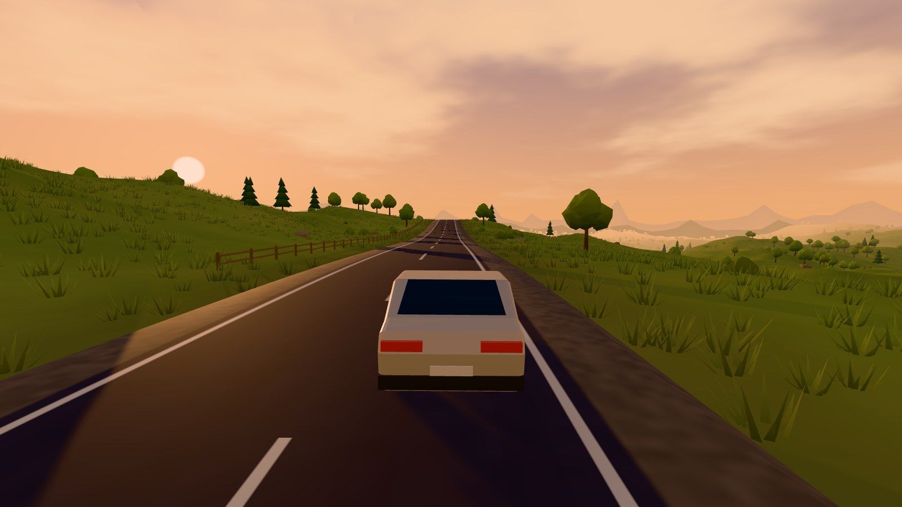
</p>

**Elsewhere** is an endless, calm driving game for the browser. Pick a place, press *Start Driving*, and keep going for as long as you like — through rolling countryside, along a sea cliff at sunset, down empty suburban streets, or round and round a parking structure that never reaches the roof. No goals, no timer, no game over.

Everything is generated procedurally and locally: the road, terrain, trees, houses, concrete decks, sky, and every sound. The whole game is a static website.

## Screenshots

<table>
  <tr>
    <td width="50%">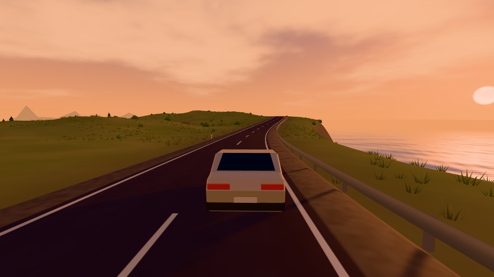<br /><sub><b>Coastal Highway</b> · Sunset</sub></td>
    <td width="50%">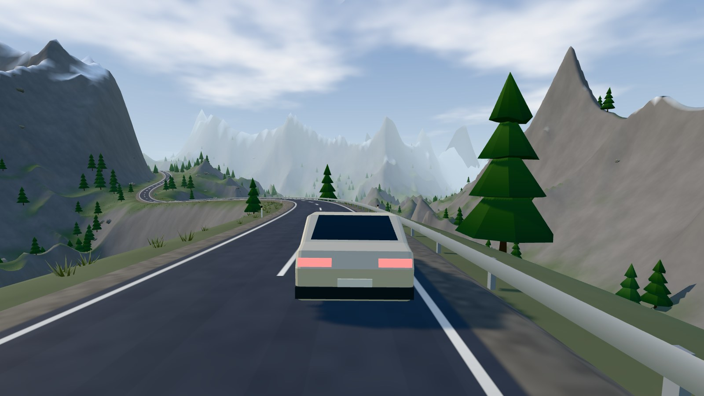<br /><sub><b>Alpine Roads</b> · Clear Air</sub></td>
  </tr>
  <tr>
    <td>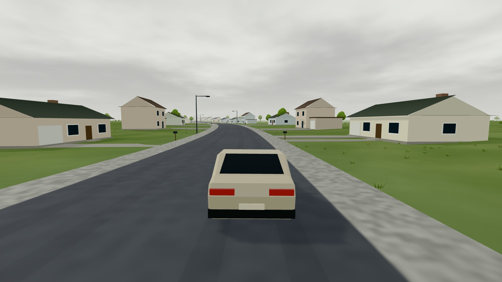<br /><sub><b>Liminal Suburbia</b> · Overcast</sub></td>
    <td>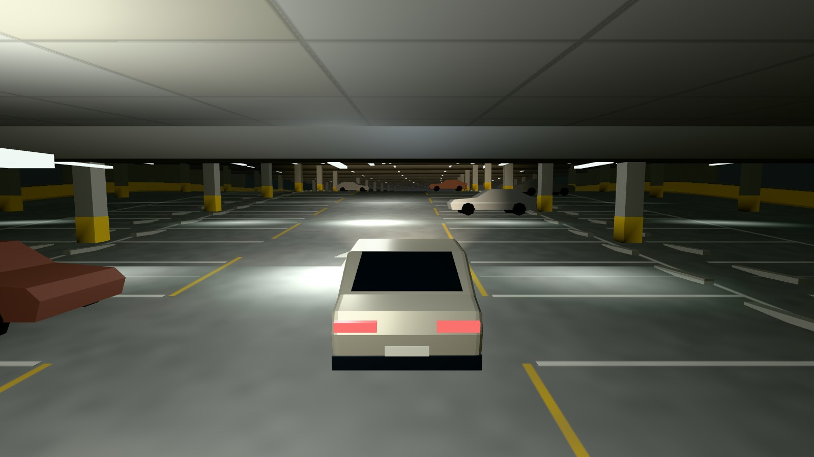<br /><sub><b>Endless Parking Structure</b> · Fluorescent</sub></td>
  </tr>
  <tr>
    <td>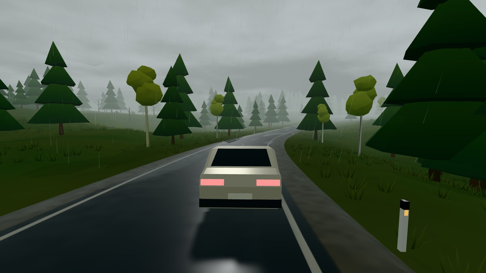<br /><sub><b>Misty Forest</b> · Rain</sub></td>
    <td>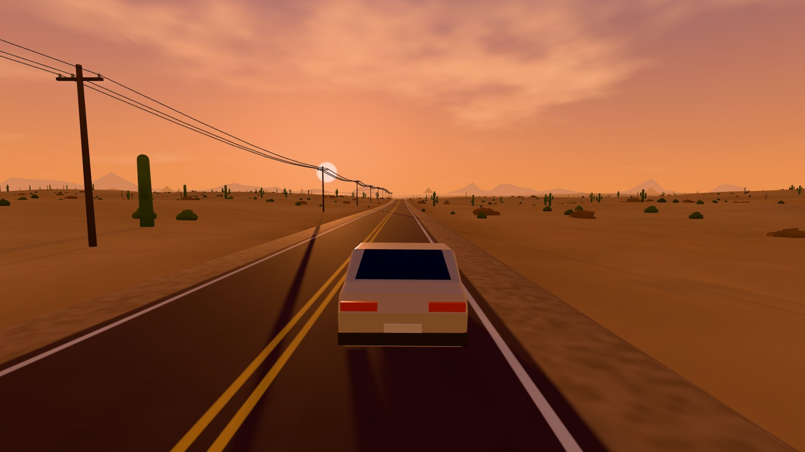<br /><sub><b>Desert Highway</b> · Sunset</sub></td>
  </tr>
  <tr>
    <td>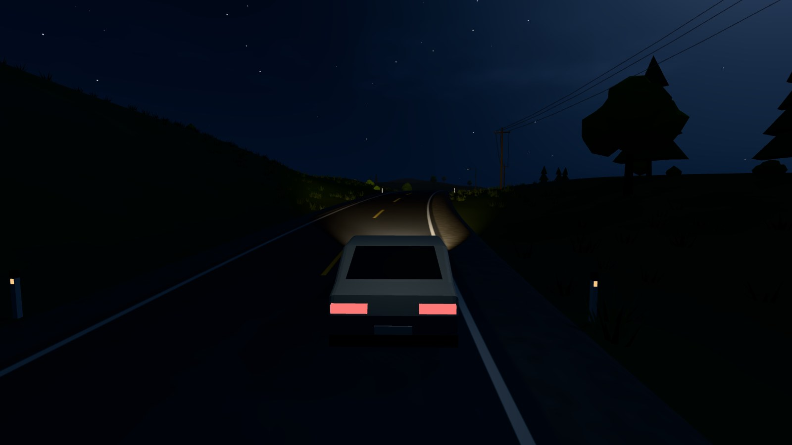<br /><sub><b>Midnight Highway</b> · Clear Darkness</sub></td>
    <td>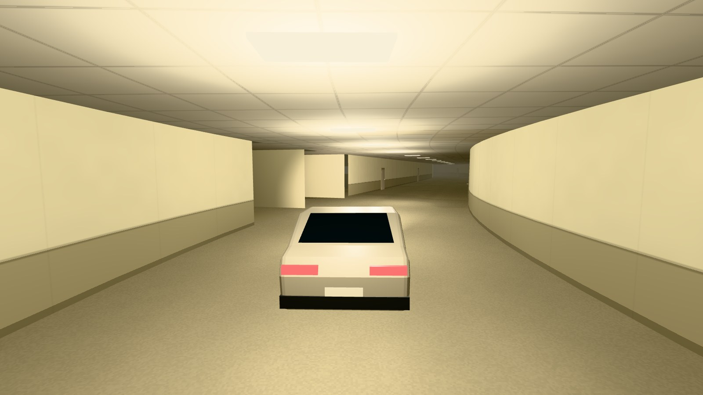<br /><sub><b>Service Corridors</b> · The Hum</sub></td>
  </tr>
  <tr>
    <td>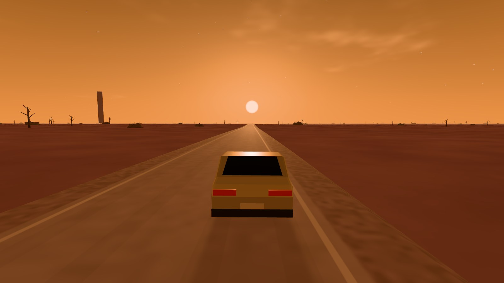<br /><sub><b>Surreal Horizon</b> · Amber Void</sub></td>
    <td>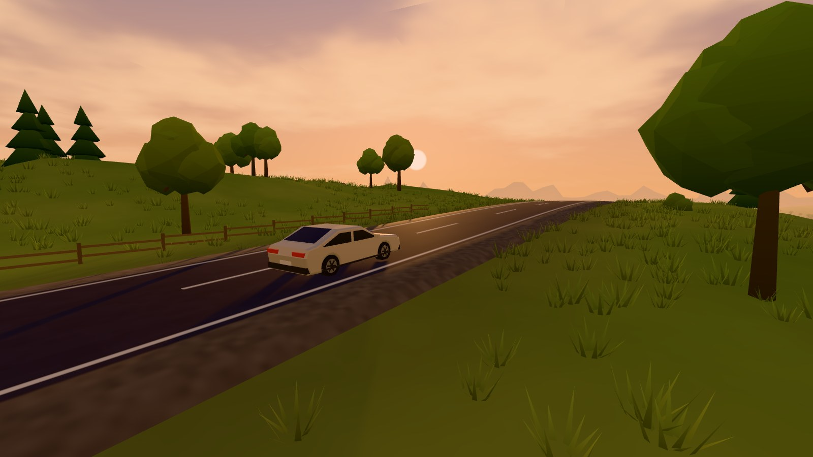<br /><sub><b>Green Highlands</b> · Menu cinematic camera</sub></td>
  </tr>
</table>

<table>
  <tr>
    <td width="50%">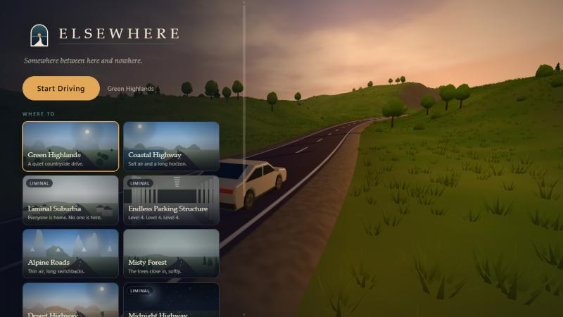<br /><sub><b>Main menu</b> — floats over a live, autopiloted drive</sub></td>
    <td width="50%">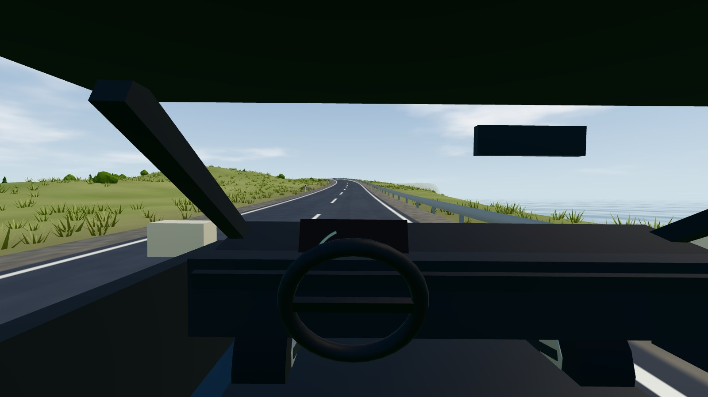<br /><sub><b>Cockpit camera</b> — press C</sub></td>
  </tr>
  <tr>
    <td>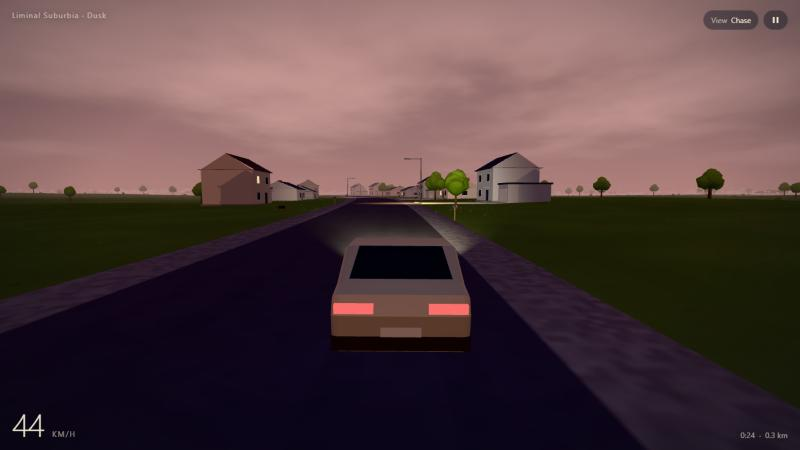<br /><sub><b>Minimal HUD</b> — Liminal Suburbia at dusk</sub></td>
    <td>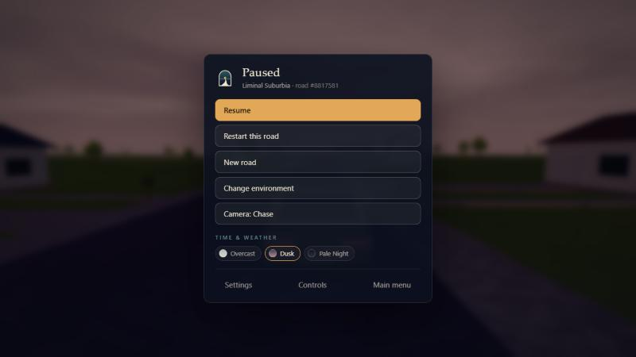<br /><sub><b>Pause menu</b> — restart, new road, time &amp; weather</sub></td>
  </tr>
</table>

<p align="center">
  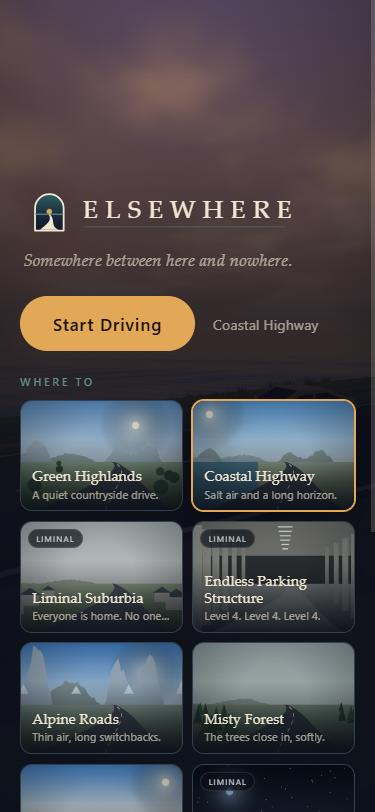
  &nbsp;&nbsp;
  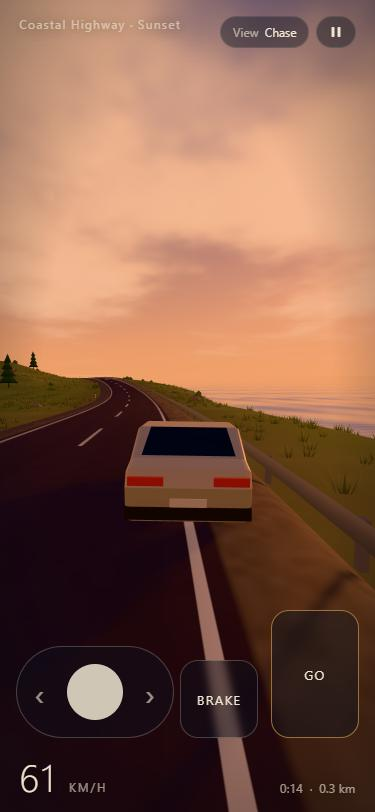
  <br /><sub><b>On a phone</b> — responsive menu and multitouch steering / pedals</sub>
</p>

---

## Quick start

Requires Node.js 20+ (developed with Node 24).

```bash
npm install
```

```bash
npm run dev
```

Open the printed URL (default `http://localhost:5173`).

| Command | What it does |
| --- | --- |
| `npm run dev` | Development server with hot reload |
| `npm run build` | Type-check (`tsc`) and build the static site into `dist/` |
| `npm run preview` | Serve the production build locally |
| `npm test` | Run the unit tests (Vitest) |
| `npm run typecheck` | Type-check only |

## Controls

| Input | Action |
| --- | --- |
| **W / ↑** | Accelerate |
| **S / ↓** | Brake, then reverse when stopped |
| **A D / ← →** | Steer |
| **Space** | Handbrake |
| **Q** | Cruise control (holds current speed; braking cancels) |
| **C** | Switch chase / cockpit camera |
| **Mouse drag** | Look around (eases back behind the car) |
| **R** | Recover to the road |
| **H** | Toggle HUD |
| **Esc / P** | Pause |

**Touch:** an analogue steering pad on the left, *Go* and *Brake* pedals on the right (multitouch: steer and accelerate together).
**Gamepad:** left stick steers, right trigger accelerates, left trigger brakes, B is the handbrake.

Driving keys only suppress browser scrolling while you are actually driving; menus and form fields keep normal keyboard behaviour. Losing window focus pauses the drive.

## Environments

| Environment | Status | Notes |
| --- | --- | --- |
| Green Highlands | Complete | Rolling hills, woodland, fences, grass, 4 moods incl. golden hour and drizzle |
| Coastal Highway | Complete | Ocean on the right, cliffs, guardrail, islands, sunset and sea haze |
| Liminal Suburbia | Complete | Repeating houses, driveways, mailboxes, streetlights, overcast/dusk/night |
| Endless Parking Structure | Complete | Pillars, bays, ramps between levels, fluorescent fixtures, parked cars |
| Alpine Roads | Complete | Ridged mountains, switchbacks, conifers, guardrails on curves, snowfall |
| Misty Forest | Complete | Dense pine/birch, damp roads, heavy fog, rain |
| Desert Highway | Complete | Long straights, telephone wires, cacti, mesas, heat-shimmer road mirage |
| Midnight Highway | Complete | Headlights, stars, reflector posts, junction lamps, fog and rain |
| Service Corridors | Experimental | Backrooms-inspired (original) carpeted service corridors, doors, side passages |
| Surreal Horizon | Experimental | Flat pastel plains with enormous distant monoliths, arches and spheres |

"Experimental" means playable and stable but less art-directed than the others.

## Project structure

```
public/
  branding/          logo.svg, logo-light-bg.svg, logo-mark.svg, icon-512.svg, brand-guide.md
  favicon.svg, manifest.webmanifest
src/
  app/               App.tsx (React shell), game-state.ts (phase machine), devTools.ts (dev only)
  config/            environments.ts, graphics.ts (presets), controls.ts, settings.ts (persistence)
  core/              seeded random, simplex noise, math helpers
  game/              GameEngine, GameLoop, WorldManager, VehicleController, CarModel,
                     CameraController, InputManager, AudioManager, AnomalySystem,
                     PerformanceManager, Autopilot, ResourceManager
  world/             RoadGenerator, TerrainGenerator, ChunkBuilder, ChunkManager,
                     SceneryGenerator, SceneryRenderer, InstancePool, RoadMeshBuilder,
                     EnvironmentManager, WeatherSystem, Sky, Water, Precipitation,
                     DistantScenery, materials/, assets/, environments/
  ui/                MainMenu, EnvironmentSelector, GameHUD, PauseMenu, SettingsMenu,
                     TouchControls, LoadingScreen, PerformanceOverlay, envThumbnails
  styles/global.css
docs/screenshots/    images used in this README
tests/               road, terrain/chunks/scenery, vehicle, config/settings/weather tests
```

### How it works

- **One engine, many presets.** An environment is pure data (`src/world/environments/*`): road shape, terrain parameters, scenery layers, roadside furniture, indoor modules, atmosphere variants and ambience. The same road generator, chunk manager, car and camera serve all ten.
- **Endless road.** `RoadGenerator` integrates a centreline at a fixed 2 m step from segments whose curvature eases from one to the next, so position, heading, curvature and elevation are continuous — no seams. Heading is bounded around +Z, which guarantees the road never crosses itself and lets any world point be matched to the road with a binary search. Elevation follows a smoothed, grade-limited version of the landscape. Everything derives from the drive seed; old road data is trimmed behind the car.
- **Terrain.** `TerrainSampler` is a deterministic height field (fbm + ridged noise) that blends to just below the road surface near the road, so the road is never buried or floating. `ChunkManager` streams 128 m chunks in LOD rings around the car with a per-frame time budget; neighbouring chunks share exact edge heights and skirts hide LOD cracks.
- **Scenery.** Placement is pure and seeded (`SceneryGenerator`), sampled on the actual rendered triangle surface so nothing floats. Rendering uses densely packed `InstancedMesh` pools with O(1) add/remove; instance transforms are re-centred periodically to stay precise on very long drives.
- **React stays out of the frame loop.** The engine owns a single `requestAnimationFrame` loop; the HUD is updated by writing to DOM nodes from a 10 Hz snapshot.
- **Atmosphere.** A procedural sky (gradient, sun, fbm clouds, stars), fog matched to the horizon, a sky-derived environment map (PMREM), sun shadows that follow the car, rain/snow particles and smooth transitions between variants. Wet roads are an approximation (darker albedo + low roughness reflecting the sky environment map); there are no real-time screen-space reflections.
- **Audio.** Entirely synthesised with the Web Audio API: engine (simple gearbox), tyre roar, gravel, wind rush, rain and thunder, per-environment ambience (birds, ocean, crickets, forest, fluorescent hum, mechanical rumble, drone), slow generative music and the optional liminal sounds. The audio context starts on the first user gesture.
- **Liminal events (optional).** Rare, quiet events — a figure at the roadside that is gone when you get close, a light that flickers once, a sourceless sound, tail lights that never get closer, ambience that falls silent, fog that thickens. Separate toggles for visual, audio and atmospheric effects; *Off* disables everything.

## Settings

Saved to `localStorage` (`elsewhere.settings.v1`) and validated on load (corrupt data falls back to defaults):
volumes (master, vehicle, ambience, music, liminal), graphics preset (Low/Medium/High), render resolution, adaptive resolution, performance overlay, top speed, steering and camera sensitivity, field of view, units, car colour, reduce motion, HUD and drive-time visibility, drifting time/weather, liminal intensity and toggles.

Graphics presets change view distance, terrain LOD, scenery and grass density, shadow mode, cloud rendering and pixel-ratio cap. Adaptive resolution only steps down after several seconds of sustained low frame rate (never on a single slow frame) and recovers slowly.

## Deploying for free

The live version runs on Cloudflare: **https://elsewhere.pathakalok256.workers.dev/**

The build is a static site with relative asset paths (`base: './'`), so it works at a domain root or a sub-path.

**Cloudflare Pages:** create a project from the repository, build command `npm run build`, output directory `dist`.

**GitHub Pages:** build locally (`npm run build`) and publish the `dist/` folder (for example with the `gh-pages` branch or an Actions workflow using `actions/upload-pages-artifact` + `actions/deploy-pages`). No server configuration is needed.

**Netlify / any static host:** upload `dist/`.

## Testing

`npm test` runs 32 unit tests covering road continuity, curvature/elevation limits, non-self-intersection, determinism, nearest-point queries, trimming and reset; terrain determinism, road-vs-terrain clearance, chunk edge continuity, chunk planning/recycling and scenery placement rules; vehicle acceleration, braking/reversing, coasting, steering, slopes, walls and cruise control; environment preset validity, graphics presets, settings persistence/repair, weather transitions and the game phase machine.

In development, `window.__elsewhere` exposes helpers used for automated browser checks (`drive(name, variant, frames)`, `soak(km)`) and `window.elsewhere` is the engine (`debugState()`, `debugAdvance()`, `debugTriggerAnomaly()`). These are not included in production builds.

## Known limitations

- Service Corridors and Surreal Horizon are marked experimental: they work but have less variety than the other eight.
- Collisions are deliberately simple: indoor walls and very steep slopes stop the car; trees, pillars, houses and parked cars are not solid.
- Water is a stylised shader without shoreline foam; wet roads use an environment-map approximation, not true reflections.
- The desert "heat haze" is a distance mirage on the road surface rather than a screen-space distortion.
- Terrain is generated on the main thread (time-sliced); very slow devices may see distant chunks fill in while driving fast on the High preset.
- Branding is SVG only; no raster (PNG) icon sizes are generated.
- Visual and touch testing was done in a desktop Chromium browser pane; real phones and Safari/Firefox were not tested.
